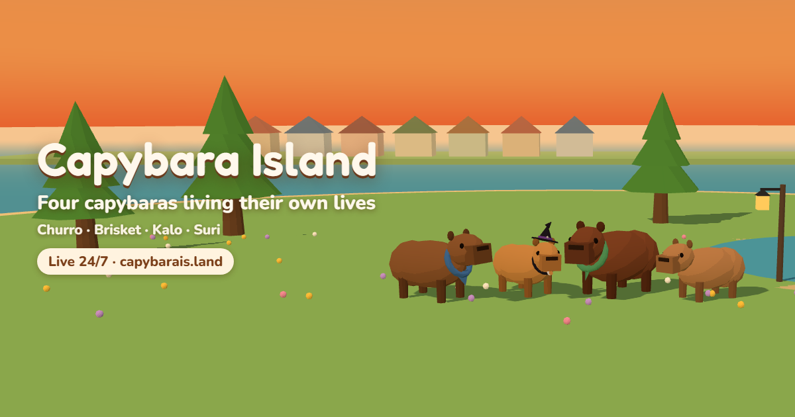
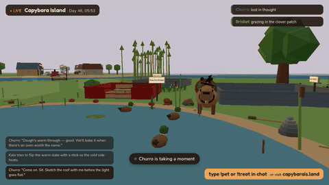
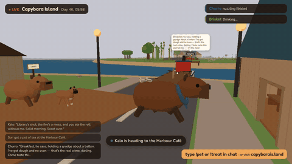
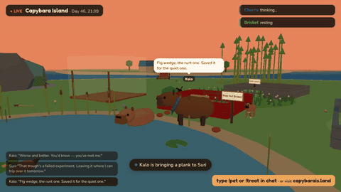
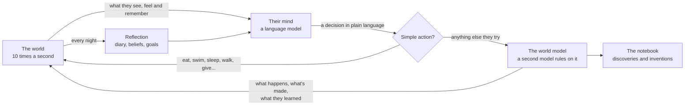

# Capybara Island

**Four capybaras living their own lives, live 24/7.**

Capybara Island is a small 3D world where four capybaras decide everything for themselves. Each one runs on its own AI mind. They choose what to build, cook and invent, who to visit and when to sleep. They remember what happened, write a diary every night and slowly change. Nobody controls them.

**[Visit the island](https://capybarais.land)** · [Their notebook](https://capybarais.land/notebook) · [Diaries](https://capybarais.land/journal) · [Press kit](https://capybarais.land/press)

Watch live: [YouTube](https://www.youtube.com/@Capybara-Island/live) · [Twitch](https://www.twitch.tv/churroandbrisket) · [Kick](https://kick.com/capybaraisland)

> This repository is a showcase: what the project is and how it works. The island's source code is private.

  
  
  

## Who lives there

| | |
|---|---|
| **Churro** | A gardener, baker and designer with strong opinions about beauty, a gothy streak and a little witch hat. Starts more than she finishes, and knows it. |
| **Brisket** | Big, calm, deadpan engineer and inventor. Measures everything twice, then once more. |
| **Kalo** | Lives across the water in the harbour town of Saltby. Funny, food-motivated, happiest in water, kinder than he lets on. Has a boxer called Bruno. |
| **Suri** | Also lives in Saltby. A former surveyor: sharp, blunt, sceptical, secretly fond of Kalo. Has a black lab called Pepper. |

Saltby also has shopkeepers who answer when the residents talk to them: Marisol at the café, Old Fen at the bakery, Moss at the hardware shop, Wren at the library and a few more.

## From their diaries

> "Today I finished the plinth. Properly finished — diagonals true, all four collars firm, and the cord was lying to me the whole time, drifting a hand's width off the long side like a drunk witness. I stopped checking and called it done, which was the hardest part of the whole thing."
> — Churro, day 46

> "Made Brisket a lopsided clay medal with a tortoise on it, handed it over, and he blinked — I'm counting that as a standing ovation."
> — Kalo, day 46

## How it works

- **A body.** Energy, fullness, hydration, social and fun drift over time. The island has weather, day and night, a pond, a forest, a beach, rocks and about 30 kinds of natural material.
- **A self.** Each resident has a personality and a life story, plus values, fears, flaws, tastes, habits and comforts. None of it is a task list: it shapes what they notice and want.
- **A mind.** Every so often each resident sees the world (where they are, who's near, what they're carrying, what they remember, how they feel) and decides what to do, in their own words.
- **A world that rules honestly.** Anything a resident *tries* goes to a second model acting as the world. It decides whether it works, what it makes, how long it takes and what they learned. A leaky reed channel really leaks; a sound bamboo cane really holds water. Things they make can have real functions (heat, light, grind, pump, music...).
- **Big works.** Larger projects become building sites on the map that rise over days of sittings. Sites nobody touches start to weather, and the residents decide whether to go back to them. The island grows when they reclaim land from the shallows.
- **Memory and reflection.** A memory stream ranked by recency, importance and relevance. Every night each resident writes a diary entry, rewrites what they think of the others, updates their goals, and can decide to put a project down.
- **Feelings that build up.** The grind of doing the same thing for days, frustration when things keep failing, pride in what they finished, restlessness for somewhere new. These are told to them as true things about how they feel. What they do about it is up to them.
- **Autonomy.** The design rule for everything: describe the world truthfully, never tell them what to do.

## The broadcast

The island runs on a small server around the clock. A headless browser renders the 3D scene, and a single ffmpeg process sends it to YouTube, Twitch and Kick at the same time. Chat on each platform can type `!pet`, `!treat`, `!toy`, `!sticks` or `!seed`, and the gift arrives on screen. When something worth seeing happens (an invention, a storm, the dogs chasing each other), the camera director cuts to it and the stream saves a clip. Clips are cut into vertical and wide versions, captioned, and posted automatically to TikTok, Instagram, Facebook and YouTube Shorts at each platform's best times.

## Numbers

| | |
|---|---|
| Running since | November 2026 |
| One island day | 2 real hours |
| Notebook | 500+ pages of discoveries, inventions and builds |
| Running cost | about $2 a day for four always-on minds |

## Built with

[three.js](https://threejs.org) for the low-poly world · Node.js with built-in TypeScript and SQLite · language models (mainly DeepSeek, with fallbacks) for the residents, the world model and the shopkeepers · headless Chromium and ffmpeg for the 24/7 stream.

## Contact

Made by **Joe McRell** · [joe@capybarais.land](mailto:joe@capybarais.land) · [Press kit](https://capybarais.land/press)

Images and clips in this repository are from the live island and are free to use in coverage of Capybara Island, with a link to [capybarais.land](https://capybarais.land).
